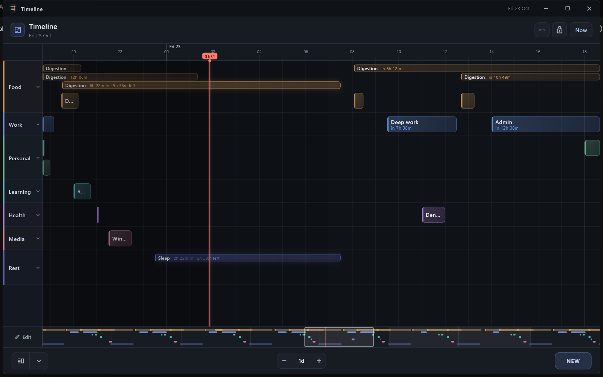

# Timeline

Timeline is a finite eight-day planner for tracking events during the day, built with Flutter for Windows and Android.



## Features

- Eight-day canvas with zoom from one hour to the full range
- Events and zones arranged in category tracks, with vertical lanes that persist
- Drag, resize, create, edit, and undo directly on the timeline
- Multi-select with Ctrl+click and Shift+drag on Windows, or long-press on Android
- Batch edit or delete selected blocks and save a whole selection as a reusable template
- Reorder or clear categories, with inline confirmation and undo
- Single-block and multi-block templates, recurring events, alarms, and a lock mode
- Quick duration steps from five minutes to one hour
- JSON import and export for local backups and moving data
- Windows tray support and Android notifications

## Requirements

- Flutter with Dart 3.13.5 or newer
- Windows 10 or 11 with the desktop toolchain for Windows builds
- Android SDK and Android 8.0 (API 26) or newer for Android builds

## Build and run

Windows:

```sh
flutter pub get
flutter run -d windows
flutter build windows --release
```

Android:

```sh
flutter pub get
flutter devices
flutter run -d <device-id>
flutter build apk --release
```

## Releases

Prebuilt Windows and Android packages are available on the [releases page](https://github.com/1sad/timeline/releases). The Windows package is portable: extract it and run `timeline.exe`. No installer is required, and only one Windows instance can run at a time.

## Data

On Windows, Timeline stores its data in `timeline-data/timeline_data.json` beside `timeline.exe`. Keep the extracted folder together and it can be moved or backed up as a portable app. If that folder is read-only, Timeline falls back to the per-user application data directory.

On Android, data stays in the app's private storage. Use the in-app JSON export and import to back up data or move it between devices. There is no cloud sync.

## Development

Built with Flutter. Developed with assistance from OpenCode using DeepSeek V4.1 Flash.

## License

GNU General Public License v3.0 only (GPL-3.0-only). See [LICENSE](LICENSE).

Copyright (C) 2026 1sad.
